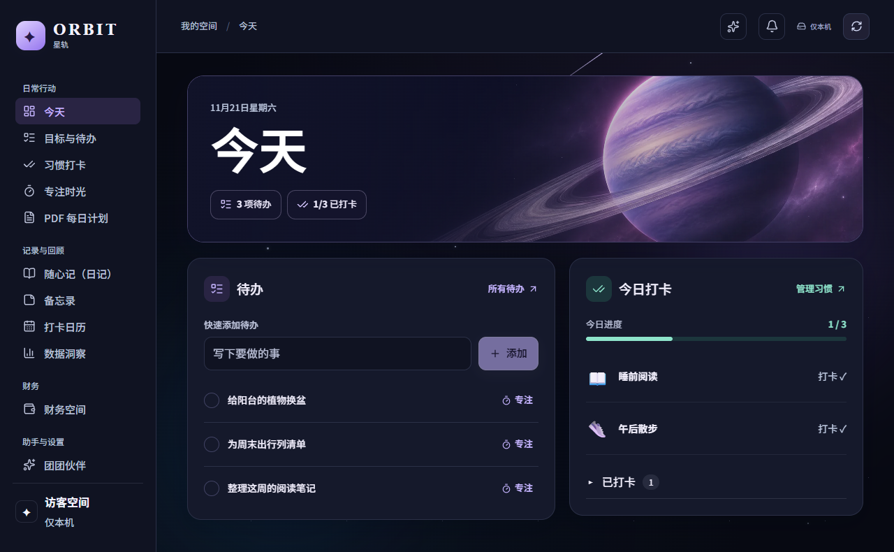

# 星轨 ORBIT

**打开就知道今天该做什么，做完就能看到自己的进度。**

星轨是一个中文日常管理工具。从「今天」查看待办和习惯打卡，从一条任务直接开始专注。临时想法可以随手记，长期目标可以拆成小步骤，每天推进一点。



*截图使用示例数据。星轨支持纸感浅色和星空深色外观。*

[在线试用](https://orbit-life-production.up.railway.app/) · [查看历史安装包](https://github.com/yinyueQvQ/orbit-life/releases) · [反馈问题或参与维护](https://github.com/yinyueQvQ/orbit-life/issues)

## 星轨可以做什么

| 想做的事 | 在哪里完成 |
| --- | --- |
| 安排今天 | 在「今天」快速添加待办、完成习惯打卡，点一条任务进入专注计时。 |
| 推进长期目标 | 把目标拆成带截止日期的待办，查看步骤和完成进度。 |
| 留下想法和见闻 | 备忘录收纳短句和素材，随心记支持图文记录与阶段回顾。 |
| 管理收支 | 财务空间集中查看实际收支、储蓄目标和下月规划。 |
| 把文档变成行动 | 导入带文字层的 PDF，生成可编辑的每日计划，确认后写入待办。 |

本机体验无需注册，记录可以导出备份。需要跨设备使用时，可以登录同一个星轨账号。登录后可预览并选择是否迁移本机记录。

## 快速开始

在线服务和历史安装包可能与当前源码版本不同。要体验本仓库的界面，可以按下面的方式从源码运行。

### 网页与本机体验

使用 Node.js 24，在仓库根目录运行：

```sh
npm ci --ignore-scripts
npm run build:local
node local/server.mjs
```

浏览器打开 `http://127.0.0.1:4318/`，选择「先体验，仅保存在本机」。Windows 也可以在构建后用「启动星轨.cmd」打开应用。

### Android 与 iOS

| 平台 | 从源码构建 |
| --- | --- |
| Android 8.0+ | Windows 上准备 Java 21、Android Build Tools 35 和 Platform 35，运行 `npm run build:android -- --side-by-side`。APK 生成在 `release/`。覆盖升级需要相同包名和签名。 |
| iOS 17+ | 运行 `npm run build:local` 和 `node scripts/prepare-ios.mjs`，再在 Mac 上用 Xcode 打开工程。真机运行需要选择开发团队签名。 [iOS 构建说明](ios/README.md) |

Android SDK 默认位于 `%LOCALAPPDATA%/Orbit/android-sdk`，也可通过 `ORBIT_ANDROID_SDK` 指定。请将签名文件和口令保留在本机。

## 一起维护星轨

欢迎从一个小改动开始，也欢迎长期参与某一端的测试和评审。以下几个方向都适合第一次贡献：

- **iOS 真机验证** · 在 Xcode 中构建，记录设备与系统版本，帮忙检查启动、备份恢复和云端登录。
- **移动端体验** · 检查窄屏和深浅色界面，报告文字截断、难点的按钮或键盘遮挡。
- **测试与文档** · 给待办、专注计时或备份恢复补一项回归测试，或完善首次安装步骤。

遇到问题可以先在 Issues 里描述设备、版本、复现步骤、预期结果和实际结果。截图请遮住待办、账单等个人信息。准备提交代码前，建议先在对应 Issue 说明想改哪一部分，方便对齐需求，也可以减少重复工作。 [打开 Issues](https://github.com/yinyueQvQ/orbit-life/issues)

```sh
npm run test:domain
npx tsc --noEmit
npm run build:local
```

**如果星轨对你有用，欢迎点个 ⭐。** 如果只能改一处，什么会让你更愿意每天打开它？欢迎在 Issues 里告诉我。

## 开发与部署

| 目录 | 用途 |
| --- | --- |
| `app/`、`components/` | 页面、导航与界面组件 |
| `shared/`、`server/` | 数据逻辑、账号 API 和同步 |
| `mobile/`、`android/`、`ios/` | 移动端运行时与原生工程 |
| `local/`、`deploy/` | 本机服务和网站部署入口 |
| `tests/` | 应用数据逻辑的自动化测试 |

Railway 部署使用仓库的 `Dockerfile` 和 `railway.json`。为星轨配置 MySQL 8.0.19 或以上版本的专用数据库，并把 MySQL 服务的私网连接串引用到星轨服务的 `ORBIT_MYSQL_URL`（例如 MySQL 服务名为 `MySQL` 时使用 `${{MySQL.MYSQL_URL}}`）。服务启动时会创建表。使用需要 TLS 的数据库时，设置 `ORBIT_MYSQL_TLS=1` 以启用证书验证。

星轨服务仍需将现有持久卷挂载为 `/data`，用于旧库迁移和 Android 安装包缓存。保留 `PORT=8080`、`ORBIT_DATA_DIR=/data`、`ORBIT_PUBLIC_ORIGIN` 和 `ORBIT_ENCRYPTION_KEY`。原有加密密钥用于解密已保存的 AI 密钥。新部署使用 32 字节随机值的 Base64 编码。

### 从 Railway 上的 SQLite 切换

1. 安排维护窗口，暂停旧版本写入，备份原持久卷和 `ORBIT_ENCRYPTION_KEY`。迁移时使用同一个持久卷，保留完整的 SQLite 数据库及存在的 WAL 文件。
2. 将星轨连接到空 MySQL 数据库，设置 `ORBIT_MIGRATE_SQLITE=1`，再启动新版本。服务在对外接收请求前迁移账号、会话、工作区、附件、加密 AI 密钥和其他账号表。迁移和完成标记在同一个事务中提交，日志只输出各表行数。
3. 检查启动日志，验证原账号登录、记录、附件和同步，再移除 `ORBIT_MIGRATE_SQLITE`。迁移标记会让重启跳过导入。切换后，新写入只进入 MySQL。旧 SQLite 备份仅能恢复到切换前的状态。

## 本机数据与可选 AI

Windows 本机数据位于 `data/orbit.sqlite`。可以从应用内导出备份，也可以先停止服务再复制整个 `data/` 目录。个人记录、API 密钥和签名文件请保留在仓库之外。发布前可运行 `node scripts/scan-secrets.mjs` 检查源码与构建产物。

AI 伙伴「团团」需要联网和 DeepSeek 密钥。启用 AI 后，聊天内容及为完成请求而读取的相关文字会发送给 DeepSeek。团团提出的记录修改需要用户确认后才会写入。PDF 也可以生成不调用 AI 的本机草稿。中文字体的授权文件位于 `public/fonts/`。
